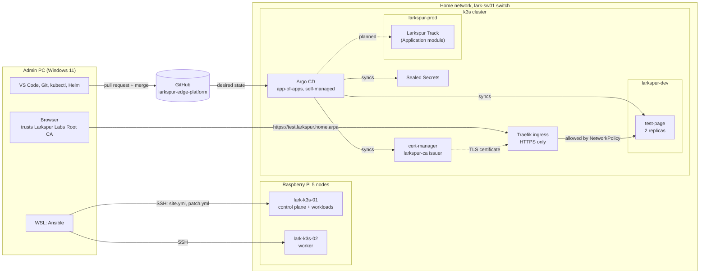

# Larkspur Edge Platform

**Larkspur Track**: an offline-first shipment tracking system for a (fictional) Larkspur Logistics regional warehouse, running on a 2-node **k3s** Kubernetes cluster of Raspberry Pi 5s, built and operated with production practices: Ansible, GitHub Actions, Argo CD (GitOps), cert-manager, Sealed Secrets, CloudNativePG, Prometheus/Grafana, and Azure for off-site backups and sync.

> **Status:** Foundation, Infrastructure and Platform done; Application core done; CI/CD next. See [docs/plan.md](docs/plan.md).

| Host | Hardware | Role |
|---|---|---|
| lark-sw01 | NETGEAR GS748Tv3 (managed) | Site switch |
| lark-k3s-01 | Raspberry Pi 5, 8 GB | k3s control plane + workloads |
| lark-k3s-02 | Raspberry Pi 5, 8 GB | k3s worker |

## Architecture

Both app namespaces enforce the `restricted` Pod Security profile, deny all network traffic by default (DNS excepted), and give the `larkspur-developers` group edit access in dev and read-only access in prod.

## Repository layout
| Path | Contents |
|---|---|
| ansible/ | Node configuration: inventory, roles (common, k3s_server, k3s_agent), site.yml (configure), patch.yml (rolling OS updates) |
| app/ | Larkspur Track (FastAPI, Jinja2, PostgreSQL): uv project, source in src/larkspur_track/, tests in tests/ |
| platform/ | GitOps manifests: bootstrap/ (root app), apps/ (Argo CD Applications), argocd/ (Argo CD Helm values), config/ (CA issuers, app namespaces and guardrails, HTTPS test page) |
| docs/ | Plan, architecture decision records, runbooks, AI-use log |

Larkspur Logistics is fictional. All data in this repository is synthetic.
