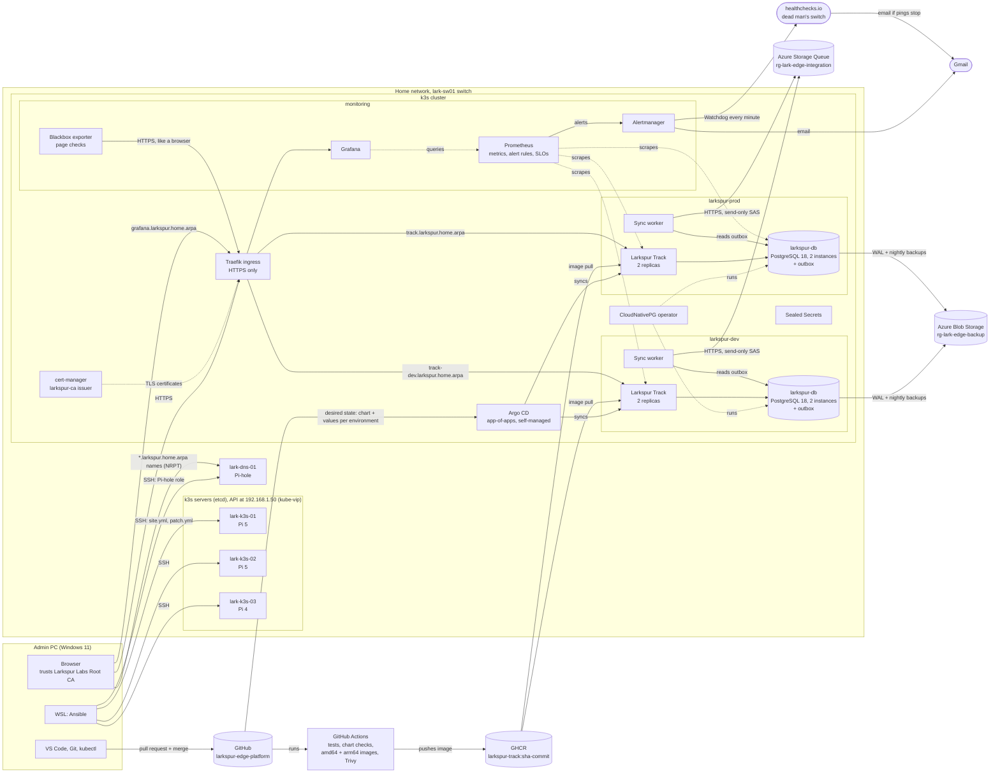

# Larkspur Edge Platform

**Larkspur Track**: an offline-first shipment tracking system for a (fictional) Larkspur Logistics regional warehouse, running on a three-server **k3s** Kubernetes cluster of Raspberry Pis that survives losing any one node, built and operated with production practices: Ansible, GitHub Actions, Argo CD (GitOps), cert-manager, Sealed Secrets, CloudNativePG, Prometheus/Grafana, and Azure for off-site backups and sync.

> **Status:** v1.0.0 released ([release notes](docs/releases/v1.0.0.md)). Phase 2, Module 1 (high availability and site DNS) done. See [docs/plan.md](docs/plan.md).

| Host | Hardware | Role |
|---|---|---|
| lark-sw01 | NETGEAR GS748Tv3 (managed) | Site switch |
| lark-k3s-01 | Raspberry Pi 5, 8 GB | k3s server (etcd) + workloads |
| lark-k3s-02 | Raspberry Pi 5, 8 GB | k3s server (etcd) + workloads |
| lark-k3s-03 | Raspberry Pi 4, 4 GB | k3s server (etcd) + workloads |
| lark-dns-01 | Raspberry Pi 4, 4 GB | Pi-hole: DNS for `larkspur.home.arpa` |
| (shared address) | 192.168.1.50 | Kubernetes API and the sites, held by kube-vip on one server at a time |

## Architecture

Both app namespaces enforce the `restricted` Pod Security profile, deny all network traffic by default (DNS excepted), and give the `larkspur-developers` group edit access in dev and read-only access in prod. Network policies admit only Traefik to the app and only the app to its database.

## High availability
All three nodes are k3s servers with embedded etcd, so the cluster survives losing any one of them; kube-vip moves the API address (192.168.1.50) to a healthy server. Each database runs a primary and a streaming replica on different nodes, and the components that fail it over or report it (the database operator and its backup plugin, Alertmanager, the page checks) run on two nodes. Measured in node-loss drills on 11-27-2026: losing the node with both database primaries took prod down for 11 min 6 s before these changes and about 90 s after (86 and 93 s), with a further 36-48 s gap at the 5-minute mark caused by etcd on SD cards. Design and drill results: [ADR-0010](docs/adr/0010-high-availability.md); procedures: [control plane](docs/runbooks/control-plane.md), [losing a node](docs/runbooks/replace-a-node.md).

## Site DNS
Pi-hole on lark-dns-01 answers for `larkspur.home.arpa` (the sites at 192.168.1.50, each Pi at its own address) and forwards everything else to Quad9. The admin PC sends only those names to it through a Windows NRPT rule, so no hosts-file entries are needed. Ansible installs and configures it. Design: [ADR-0011](docs/adr/0011-site-dns.md); procedures: [docs/runbooks/dns.md](docs/runbooks/dns.md).

## Environments
| Environment | URL | Namespace | Release (image tag) set in |
|---|---|---|---|
| dev | https://track-dev.larkspur.home.arpa | larkspur-dev | charts/larkspur-track/values-dev.yaml |
| prod | https://track.larkspur.home.arpa | larkspur-prod | charts/larkspur-track/values-prod.yaml |

Releases are pull requests that change the image tag; rollbacks are reverts. See [docs/runbooks/release-and-rollback.md](docs/runbooks/release-and-rollback.md).

Each shipment belongs to a customer (the company the warehouse handles goods for). Storing it records a bin (for example `A-03-2`), and picking it records a dock door and the carrier that collects it; search also finds shipments by bin. Supervisors manage customers, carriers, bins and dock doors on the Setup page. Dev shows a DEV badge in the header. The shipment list filters by status, customer and received date, sorts, pages 25 at a time and downloads the filtered list as CSV. The Dashboard shows shipments by status, today's activity, received and shipped per day for 14 days, and the shipments waiting longest. Sample users and a shipment history can be added once per environment with `platform/sample-data/add-sample-data.ps1` (see the user administration runbook).

Both environments require sign-in, with clerk, supervisor and admin roles and an append-only audit log (ADR-0006). Users are managed on the Users page; see [docs/runbooks/user-administration.md](docs/runbooks/user-administration.md).

## Backups
Each database archives every change (WAL) to its own private container in Azure Blob Storage and takes a full backup every night, kept 30 days, through CloudNativePG's Barman Cloud plugin. Targets: lose at most 5 minutes of data (RPO) and be back within 30 minutes (RTO); measured in a restore drill: changes reached Azure within 2-5 seconds and a database was rebuilt from Azure in 71-81 seconds. Design: [ADR-0008](docs/adr/0008-database-backups.md); procedures and the drill: [docs/runbooks/backups.md](docs/runbooks/backups.md). The Azure side is Bicep in `azure/backup/`.

## Sync to Azure (offline-first)
Every shipment change is saved together with an event in an outbox table, in the same transaction. A sync worker in each environment sends the events, oldest first, to that environment's Azure Storage Queue with a token that can only add messages; when the internet is down, events wait in the outbox and staff keep working. Delivery is at least once, so receivers dedupe by `event_id`. Measured in an uplink-cut drill: 7 of 7 events made during an outage (with a worker restart) reached Azure 5 seconds after the link returned, with no duplicates. Design: [ADR-0009](docs/adr/0009-offline-first-sync.md); procedures and the drill: [docs/runbooks/sync.md](docs/runbooks/sync.md). The Azure side is Bicep in `azure/integration/`.

## Monitoring
Prometheus scrapes the app, both databases, cert-manager, the nodes and Kubernetes itself; the blackbox exporter checks each page over trusted HTTPS from inside the cluster. Alertmanager emails warning and critical alerts, each linking to its section in [docs/runbooks/alerts.md](docs/runbooks/alerts.md); a healthchecks.io dead man's switch emails if alerting itself stops. Design: [ADR-0007](docs/adr/0007-monitoring-and-alerting.md).

| SLO (prod, rolling 7 days, health checks excluded) | Target |
|---|---|
| Requests that succeed (no 5xx) | 99.5% |
| Requests answered within 1 second | 99% |

Dashboards: https://grafana.larkspur.home.arpa (**Larkspur Track** shows the SLOs, traffic, shipments, sign-ins and page checks). Prometheus, Alertmanager and Argo CD are reached with `kubectl port-forward` (see the runbook).

## Repository layout
| Path | Contents |
|---|---|
| ansible/ | Node configuration: inventory, roles (common, k3s_server, k3s_agent, pihole), site.yml (configure), promote-to-server.yml, patch.yml (rolling OS updates) |
| app/ | Larkspur Track (FastAPI, Jinja2, PostgreSQL) and its sync worker: uv project, source in src/larkspur_track/, tests in tests/ |
| platform/ | GitOps manifests: bootstrap/ (root app), apps/ (Argo CD Applications), drills/ (restore, uplink-cut and node-loss drills, not synced), sample-data/ (sample users and shipments script, not synced), argocd/ (Argo CD Helm values), alertmanager/ (alert email template and sealing script), config/ (CA issuers, app namespaces and guardrails, databases and their monitoring, sealed sync credentials, Traefik settings, monitoring rules and dashboards, HTTPS test page) |
| charts/ | Helm chart for Larkspur Track (web Deployment, sync worker, migration job, Service, Ingress, Certificate, network policies, ServiceMonitor and PodMonitor, alert rules) with per-environment values |
| azure/ | Bicep and scripts for the Azure side: backup storage and sync queues, budgets, per-environment backup and sync credentials |
| docs/ | Plan, [install guide](docs/install.md) (rebuild from blank SD cards), [architecture decision records](docs/adr/README.md), runbooks, [interview guide](docs/interview-guide.md), [release notes](docs/releases/v1.0.0.md), AI-use log |
| .github/ | CI: pull request checks, multi-arch image builds to GHCR (amd64 + arm64), Dependabot |

Larkspur Logistics is fictional. All data in this repository is synthetic.
